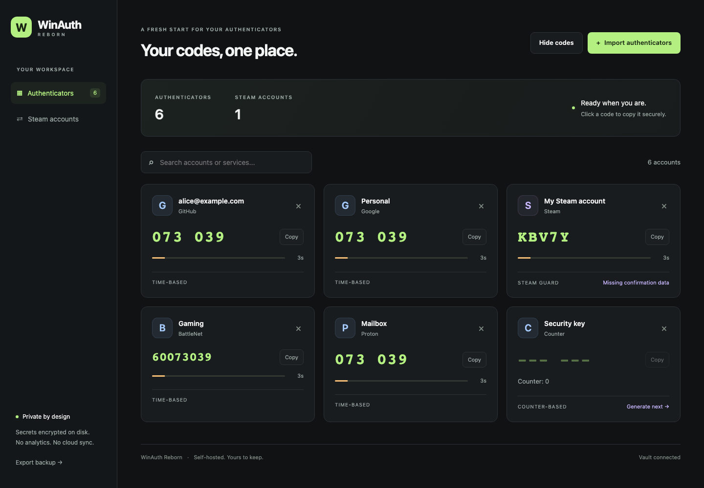

# WinAuth Reborn

A small, self-hosted replacement for WinAuth: Python server, plain HTML/CSS/JavaScript,
and a responsive dark UI. Import your original **WinAuth plain-text `.txt` export**,
copy live codes, and manage Steam confirmations in one place.



**Status:** initial alpha. MIT-licensed; no affiliation with Valve or WinAuth.

## Run locally

Requires Python 3.11 or newer.

```sh
python3 -m venv .venv
source .venv/bin/activate
python -m pip install -e .
cp .env.example .env
```

Edit `.env`: set `WINAUTH_USERNAME` and a **long, unique** `WINAUTH_PASSWORD`.
There is deliberately no default password. Protect the configuration:

```sh
chmod 600 .env
python -m winauth_reborn
```

Open <http://localhost:8080> and sign in at the browser's HTTP Basic Auth prompt.
The app uses Waitress, not Flask's development server. It binds to loopback by default.
Do not enable Flask debugging on a server holding real secrets.

An alternative to storing the Basic Auth password in plaintext is
`WINAUTH_PASSWORD_HASH`, generated locally with Werkzeug:

```sh
python -c 'import getpass; from werkzeug.security import generate_password_hash; print(generate_password_hash(getpass.getpass("Basic Auth password: ")))'
```

Set that hash in `.env` and remove `WINAUTH_PASSWORD`. Both settings and the
environment are **server configuration**, never sent to the browser.

## Import and use

In WinAuth, choose **Export** and save an unencrypted `.txt` export. For Steam,
include the full authenticator data rather than a compatibility-only URI.
Use **Import authenticators** to select/drop the file, or paste its contents.

- Each non-empty, non-comment line is an `otpauth://totp/...` or `otpauth://hotp/...` URI.
  UTF-8 BOMs, WinAuth label encoding, `issuer`, `digits`, `algorithm`, `period`,
  and `counter` are supported.
- Steam's Base32 login secret, `deviceid`, and URL-encoded JSON `data` are preserved.
  The login code is Steam's five-character code, not a numeric TOTP.
- Battle.net's eight-digit TOTP and `serial` parameter are supported. Unknown URI
  parameters, including WinAuth icons, survive export; custom icons are not rendered.
- Invalid imports fail atomically with a line number. Repeated accounts are skipped;
  they never reset a HOTP counter or overwrite a stored Steam session.
- **Copy** or click a live code. Codes are generated server-side; countdowns use
  elapsed time rather than your browser's wall clock. Copy requests a fresh TOTP.
  Clipboard permissions require **HTTPS** or **localhost**.
- HOTP uses **Generate next**. This generates the current counter's code and
  advances the counter atomically. Copying that generated code does not advance it
  again. It remains visible until the page reloads. Generate only when you need it.
- **Hide codes**, search, and the Steam-only filter work on desktop and mobile.
- **Export backup** downloads a WinAuth-compatible plaintext `.txt`, including
  current HOTP counters but excluding saved Steam web sessions. Treat it as a secret.

Encrypted ZIP/PGP exports and WinAuth XML configuration files are **not** plain-text
exports. Decrypt or export to plaintext locally before importing; this app does not
enroll new hardware authenticators, recover lost secrets, or migrate device-bound
WinAuth encryption. It copies **one-time authentication codes**, not account passwords.

## Steam confirmations

The integration uses the modern `IAuthenticationService` credential login flow,
Steam Guard verification, session polling, Community cookie transfer, and JSON
`mobileconf/getlist` / `mobileconf/ajaxop` endpoints. It does not scrape the old
WinAuth confirmation HTML.

1. Import a full Steam URI containing `data.identity_secret`.
2. Open **Confirmations** on the Steam account card and connect with that account's
   Steam username/password. The imported Steam Guard secret supplies the mobile
   code automatically; an email challenge is presented when Steam requests one.
3. Review each confirmation's headline, summary, and reference, then explicitly
   **Approve** or **Reject**, with a second confirmation prompt. Nothing is approved
   in the background or in bulk.

The password is never persisted; the Steam Community session cookie is encrypted
in the vault. **Disconnect** removes the saved cookie (it does not revoke sessions
at Steam). Reconnect when Steam expires the session. An alternative connection form
accepts your own `steamLoginSecure` cookie and SteamID64, verifies them against the
confirmation endpoint, then saves them encrypted.

Steam server time is queried before login/confirmation operations and refreshed
every five minutes during use. Ordinary TOTP depends on the server's system clock:
enable NTP. Steam actions surface expired sessions, missing secrets, rejected
requests, and connectivity errors rather than reporting false success.

**Limitations:** Valve's unofficial web/mobile endpoints may change, challenge a
login, require its official app, enforce Family View restrictions, or rate-limit
requests. Old exports with no `identity_secret` can generate login codes but cannot
authorize confirmations. A login session cannot replace that missing secret.
If you previously imported a compatibility-only Steam URI, back up the vault,
remove that incomplete account, and import the full export; duplicate imports
intentionally do not replace existing accounts.
Protocol behavior is covered by mocked regression tests; **a successful live login
and trade approval must still be verified with your account**. No real account or
trade was used to test this project.

## Deploy on the web

This is a **single-owner vault**, not a multi-user password manager. All clients
using the configured Basic Auth credentials can access the same accounts. Basic
Auth protects every route, including static files and APIs; writes additionally
require the app's CSRF header. Credentials and codes are not stored in browser
localStorage or a service worker.

Use **HTTPS**, keep the application port private, and terminate TLS at a reverse
proxy. Basic Auth is only encoded, not encrypted, over plain HTTP. For example,
with Caddy on the same machine:

```caddyfile
auth.example.com {
    reverse_proxy 127.0.0.1:8080
}
```

Set `WINAUTH_HTTPS_ONLY=true` to enable HSTS on responses when deployed behind TLS.
This flag does **not** create certificates or check trusted forwarded headers:
restrict access to the upstream port. Leave it false for local HTTP development.
Apply authentication brute-force/rate-limit controls at your ingress, limit the
service to trusted users/VPN when possible, and avoid proxies that log request
bodies or Authorization headers.

The app runs as one process with threaded request handling. SQLite transactions
protect counter advancement and imports. Do not run multiple independent app
processes: CSRF tokens, Steam time offsets, and pending email challenges are
process-local. Waitress's default eight threads provide concurrency without that
split state.

### Docker

```sh
cp .env.example .env
# Edit .env and set a long, unique WINAUTH_PASSWORD.
chmod 600 .env
docker compose up --build -d
```

If you already configured `.env`, keep it instead of copying the example over it.
Compose publishes only
`127.0.0.1:8080` and saves the vault in a named volume. Put HTTPS in front of it as
above. The container runs as an unprivileged user. To access it from a separate
proxy container, use a private Docker network instead of making the port public.

### Backups and encryption

`WINAUTH_DATA_DIR` (default `./data`) contains `vault.sqlite3` and `vault.key`.
All account payloads, including names, secrets, URI metadata, and saved Steam
cookies, are encrypted with Fernet. The directory is mode `0700`, and the key and
database are mode `0600`. Paths resolve relative to the working directory.

Back up **both files together** while the server is stopped, and protect that
backup separately from the running host. Losing the key makes the database
unrecoverable; do not regenerate it. Encryption at rest limits accidental
database exposure, but an attacker with access to the server and key can decrypt
the vault. It is not a substitute for host security. Plaintext import/export files,
browser clipboard contents, and screenshots remain sensitive.

## Development

```sh
python -m pip install -e '.[dev]'
python -m pytest
ruff check .
ruff format --check .
node --check winauth_reborn/static/app.js
```

Tests use synthetic fixtures and mocked Steam responses, never real credentials.
Browser tests use Playwright; install Chromium with `playwright install chromium`
if it is not already available.

## Compatibility references

This is a new implementation, not a port of WinAuth's C# code. The original
WinAuth project is GPLv3; its export format was checked against
[`WinAuthAuthenticator.ToUrl`](https://github.com/winauth/winauth/blob/master/WinAuth/WinAuthAuthenticator.cs)
and [`WinAuthHelper.ImportAuthenticators`](https://github.com/winauth/winauth/blob/master/WinAuth/WinAuthHelper.cs).
Steam protocol behavior was cross-checked against the public
[steampy login](https://github.com/bukson/steampy/blob/master/steampy/login.py) and
[confirmation](https://github.com/bukson/steampy/blob/master/steampy/confirmation.py)
implementations. This project is not affiliated with Valve or the original WinAuth.
